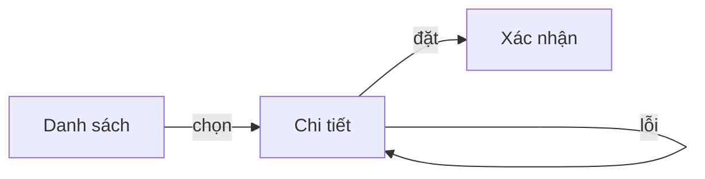

# UX Flow — Template

Copy to `docs/specs/YYYY-MM-DD-<topic>-ux-flow.md`. Sections marked
**[REQUIRED]** always appear; the rest are added when the work needs them.

Prose stays in the project's working language. Ids (`A1`, `J1`, `S1`) are what
specs and plan tasks cite — keep them stable once confirmed.

---

````markdown
# Luồng UX <tên công việc>

**Trạng thái:** CHƯA CHỐT | ĐÃ CHỐT (YYYY-MM-DD)
**Căn cứ:** <yêu cầu / concept brief>  ·  **Hồ sơ hệ thống:** docs/system-profile.md
**Nguồn thiết kế:** <link Figma | không có>

## Vai                                                 [REQUIRED]
| Id | Vai | Muốn đạt gì | Dùng trên |
|----|-----|-------------|-----------|
| A1 | <khách hàng> | <đặt hàng nhanh> | <mobile> |

## Hành trình                                          [REQUIRED]

### J1 — <tên>
- **Vai:** A1  ·  **Điểm vào:** <từ đâu tới>  ·  **Kết quả:** <thấy được gì khi xong>
1. S1 — <người dùng làm gì> → S2
2. S2 — <...> → thành công: S3 · lỗi: S2 (báo lỗi tại chỗ)
- **Dừng giữa chừng:** <hủy / bị từ chối / không có quyền → về đâu>



## Màn hình                                            [REQUIRED]

### S2 — <tên>
- **Đọc:** <dữ liệu, bằng lời của nghiệp vụ — của ai, lọc/sắp thế nào>
- **Gửi:** <hành động → kết quả khi được · khi lỗi>
- **Trạng thái:** đang tải · rỗng: <thấy gì, làm được gì> · lỗi: <...> ·
  không có quyền: <...>   ← chỉ những trạng thái thật sự xảy ra

## Luật nghiệp vụ                                      [REQUIRED]
| Luật | Nguồn |
|------|-------|
| <ai được hủy đơn, đến lúc nào> | ✓ user chốt · ~ suy từ repo · CHƯA CHỐT |

## Câu hỏi còn mở                                      [nếu có]
Mỗi dòng một câu cho user, kèm màn/hành trình bị chặn.

## Ngoài phạm vi                                       [nếu có]
Hành trình cố ý không làm lần này, kèm lý do.
````
